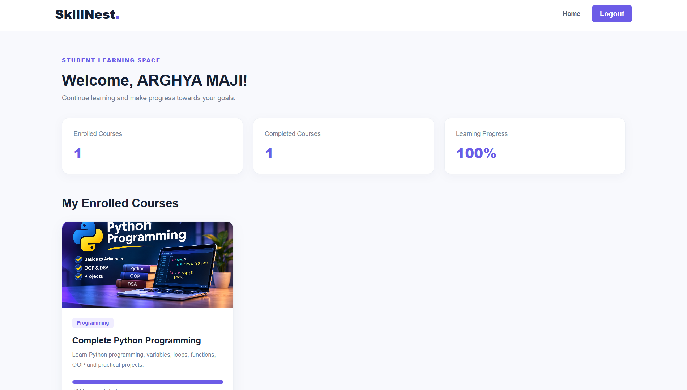
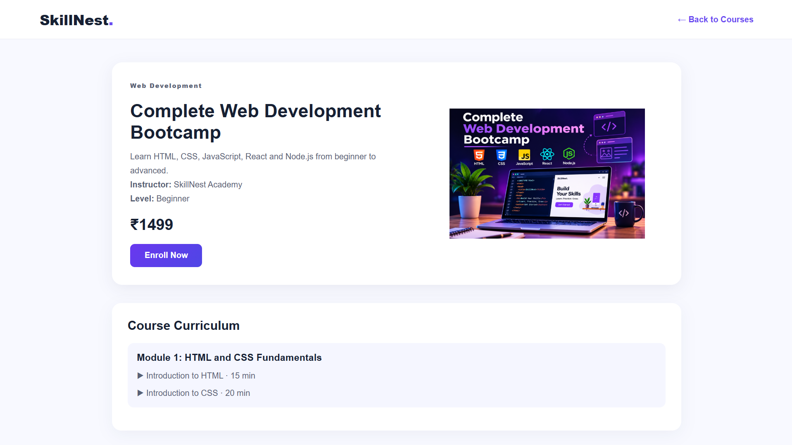
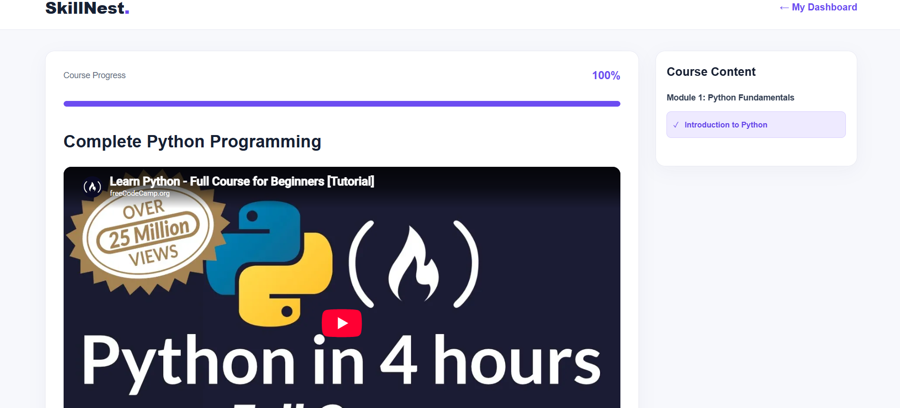
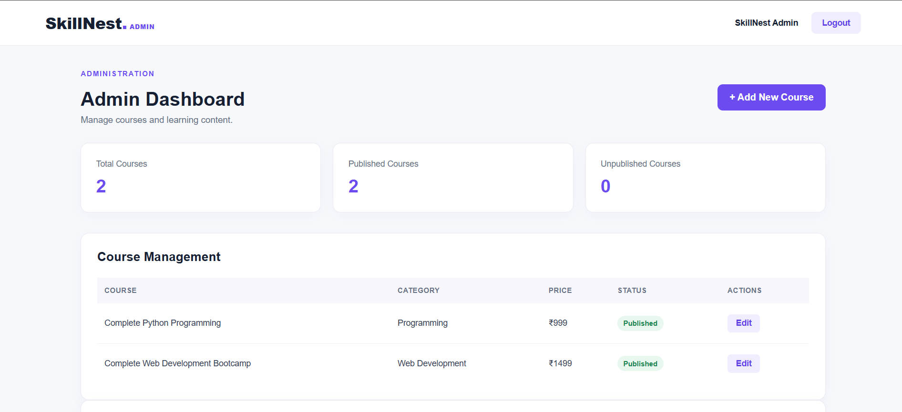
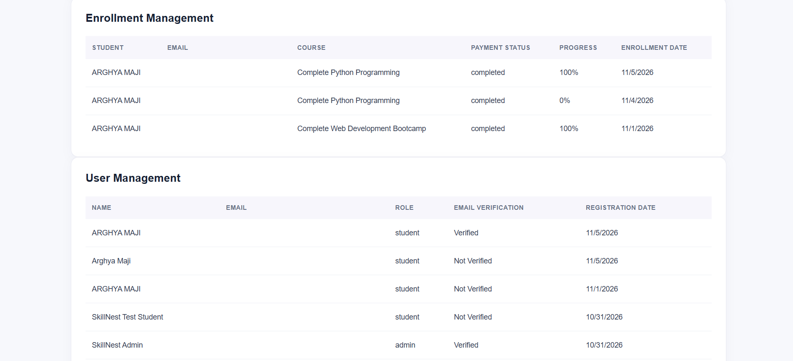

# SkillNest – Online Course Platform

A full-stack online learning platform developed as part of the **Synent Technologies Internship – Task 8**.

SkillNest allows students to discover courses, enroll through Razorpay Test Mode, watch lessons, and track their learning progress. Administrators can manage courses, monitor enrollments, and view registered users.

## Features

### Student Features
- Student registration and login with JWT authentication.
- Email verification.
- Forgot password and password reset.
- Browse and explore available courses.
- Course details and enrollment.
- Razorpay Test Mode payment integration.
- Student dashboard with enrolled courses.
- Video lessons and learning progress tracking.
- Mark lessons as completed.

### Admin Features
- Admin authentication and dashboard.
- Create, edit, and manage courses.
- Manage course modules and lessons.
- View student enrollments and payment status.
- View registered users and email verification status.

### Additional Features
- MongoDB database integration.
- Email notifications using Nodemailer.
- Responsive student and admin interfaces.
- Course search and filtering.

## Technology Stack

**Frontend**
- React 19
- Vite 8
- React Router
- Axios
- Recharts
- Lucide React

**Backend**
- Node.js
- Express.js
- MongoDB
- Mongoose
- JWT Authentication
- bcryptjs
- Nodemailer
- Razorpay Test Mode

## Project Structure

```text
synent-task8-online-course-platform-arghya-maji/
├── client/
│   ├── public/
│   └── src/
│       ├── components/
│       ├── pages/
│       ├── services/
│       └── App.jsx
├── server/
│   ├── config/
│   ├── controllers/
│   ├── middleware/
│   ├── models/
│   ├── routes/
│   ├── scripts/
│   └── utils/
├── screenshots/
└── README.md
```

## Installation and Setup

### Prerequisites
- Node.js and npm
- MongoDB Atlas account or local MongoDB
- Razorpay Test Mode account
- Gmail account with App Password access for email notifications

### 1. Clone the repository

```bash
git clone YOUR_GITHUB_REPOSITORY_URL
cd synent-task8-online-course-platform-arghya-maji
```

### 2. Install frontend dependencies

```bash
cd client
npm install
```

### 3. Install backend dependencies

Open another terminal:

```bash
cd server
npm install
```

### 4. Configure environment variables

Create a `.env` file inside the `server` folder.

```env
PORT=5000
MONGO_URI=your_mongodb_connection_string
JWT_SECRET=your_jwt_secret
CLIENT_URL=http://localhost:5173

RAZORPAY_KEY_ID=your_razorpay_test_key_id
RAZORPAY_KEY_SECRET=your_razorpay_test_key_secret

EMAIL_USER=your_gmail_address
EMAIL_PASS=your_gmail_app_password
EMAIL_FROM=SkillNest <your_gmail_address>

ADMIN_PASSWORD=your_admin_password
```

Replace the example values with your own credentials. Never upload the actual `.env` file to GitHub.

### 5. Run the backend

From the `server` directory:

```bash
npm run dev
```

Backend URL:

`http://localhost:5000`

### 6. Run the frontend

From the `client` directory:

```bash
npm run dev
```

Frontend URL:

`http://localhost:5173`

## Available Scripts

### Frontend

```bash
npm run dev
npm run build
npm run lint
npm run preview
```

### Backend

```bash
npm run dev
npm start
```

## Payment Integration

SkillNest uses Razorpay Test Mode for payment testing.

**Important:** Test Mode is intended for simulated transactions and does not process real payments.

## Screenshots

### 1. Home Page


### 2. Student Dashboard


### 3. Course Details


### 4. Learning Interface


### 5. Admin Course Management


### 6. Admin Enrollment and User Management


## Demonstration Video

Watch the complete SkillNest project demonstration:

[▶ Watch SkillNest – Internship Project Demo](c:\Users\HP\Desktop\SkillNest_Internship_Demo_Arghya_Maji_2026.mp4.mp4)

## Security Notes

- Environment variables and credentials must remain private.
- Passwords are hashed before database storage.
- JWT authentication protects secured routes.
- Administrative API routes require admin authorization.
- Payment verification is performed on the backend.

## Project Information

**Project:** SkillNest – Online Course Platform  
**Internship:** Synent Technologies  
**Task:** Task 8  
**Developer:** Arghya Maji

---

*Developed as an internship project to demonstrate full-stack web development, authentication, payment integration, and course management.*